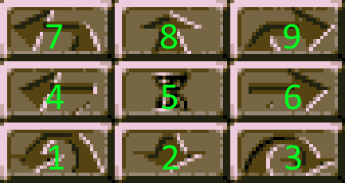
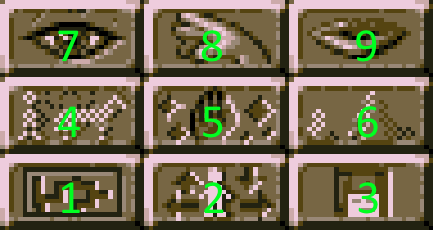
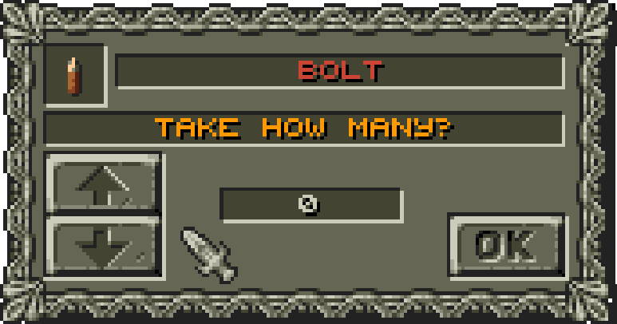

# Controls

## General (work everywhere)

Input | Action
--- | ---
1 to 6 | Select party member 1 to 6 as the active one
F1 to F6 | Open the inventory of party member 1 to 6
F7 | Open or close the quest log
F8 | Change the graphic filter (hold Ctrl, Shift or Alt to change backwards)
F9 | Change the graphic overlay (hold Ctrl, Shift or Alt to change backwards)
F10 | Change the color effect (hold Ctrl, Shift or Alt to change backwards)
F11 | Switch between window, fullscreen and fullsized window
PrintScreen | Take a screenshot (stored in the folder Screenshots)
Ctrl + P | Take a screenshot (stored in the folder Screenshots)
Ctrl + M | Toggle the music
Ctrl + , | Lower the volume
Ctrl + . | Increase the volume
Ctrl + 0 to 9 | Quick save in slots 1 to 10 (0 is slot 10)
Ctrl + Shift + 0 to 9 | Quick load from slots 1 to 10 (0 is slot 10)
Ctrl + Shift + C | Center the window on the main monitor
Escape | Generally aborts or closes things
Return | Generally submits or closes things, toggles the action buttons in the map view
Space | Generally closes things, in 3D it activates events or NPCs in front of you
NumPad 1 to 9 | Action buttons in the lower right corner (see below)

The battle speed can be changed in the options (it no longer has a key).

## Map

Input | Action
--- | ---
Up or W | Move up (2D) or forward (3D)
Down or S | Move down (2D) or backward (3D)
Left or A | Move left (2D) or turn left (3D)
Right or D | Move right (2D) or turn right (3D)
Q and E | Turn left and right in 3D if the 3D movement option is set to WASDQE (A and D strafe then)
M | Show the world map in 2D (if a party member owns the map of Lyramion) or the automap in 3D
I | Toggle the immersive mode
Space | Interact with things in front of you (3D)

If the option "turn with arrow keys" is active, the left and right arrow keys turn in 3D.

The action buttons on the lower right show the actions (eye, hand, mouth, etc) by default. You can toggle them to the movement buttons and back with either a right click on them or the return key. The num pad enter key works as well. You can also click the small arrow at the lower right corner below the buttons.

#### Immersive mode

The key I or the icon in the upper right corner toggles the immersive mode on 2D and 3D maps. The map then covers the whole screen and you see much more of it. The portraits move up and only the names of the party members stay visible. You can still click the names to select a party member or right click them to open the inventory.

A small bar below the names shows the map name, the compass, the clock and the other special items. Hover over a shortened map name to see the full name. The coordinates are shown at the bottom center and the active spells at the lower left. The small arrow at the right shows or hides the action buttons. The num pad keys always work, even if the action buttons are hidden. Windows like the inventory are shown as usual and the immersive mode returns when you close them.

#### 2D Maps

You can right click on the map to transform the cursor into a crosshair cursor. Using it will perform any suitable interaction of the following type: Eye, Hand or Mouth.

Hovering over the player the cursor becomes Zzz. Left clicking will wait for 5 minutes.

The mouse wheel changes the cursor. Clicking the mouse wheel shows the crosshair or mouth cursor.

#### 3D Maps

Hovering over the map view will change the cursor to movement arrows or Zzz in the center.

You will move faster if the mouse is at the edge of the view and slower if it is more in the center.

Left clicking in the center (Zzz) will wait for 5 minutes.

Right clicking in the center will interact with things in front of you.

#### World map and automap

Input | Action
--- | ---
Escape, Space or M | Close the world map or the automap (Return closes the world map as well)
Mouse wheel | Zoom the world map
Drag with the left mouse button | Move the world map

## Lists and scrollable areas

Input | Action
--- | ---
Up and Down | Scroll by one line (or one row of items)
Page Up and Page Down | Scroll by one page
Home (Pos1) and End | Scroll to the start or to the end

The mouse wheel works as well.

## Amount popups

Input | Action
--- | ---
Page Up | Max amount
Page down | Min amount (0)
Home (Pos1) | Min amount (0)
End | Max amount
Up | +1
Down | -1
Return | Confirm
Escape | Abort

Right clicking on the arrow buttons will select the minimum or maximum as well but right clicking somewhere else will close the popup and abort.

## Inventory

Input | Action
--- | ---
Ctrl + Left Click | Use item
Shift + Left Click | Equip or unequip item

Right clicking a stack of items will take all of them immediately. Left clicks would open the amount popup to select how many you want to take.

Dragging items can be aborted with right click or escape key.

## Battle

Input | Action
--- | ---
Space or left click | Acknowledge battle actions and texts
Escape | Abort the selection of a target or a battle field position

The default battle speed requires you to click after actions. All other speeds (+x%) will execute battle actions automatically at a given pace. The battle speed can be changed in the options.

The targets of spells and items for your own party members can be selected on the battle field or by their portraits.

## Version selection, main menu and character creation

Input | Action
--- | ---
Up and Down | Select a game data version (version selection)
Page Up / Home and Page Down / End | Select the first or the last game data version
Return or Space | Start the selected version, or continue or start a game in the main menu
Up/Left and Down/Right | Change the portrait (character creation)
Return | Confirm the character (character creation)
